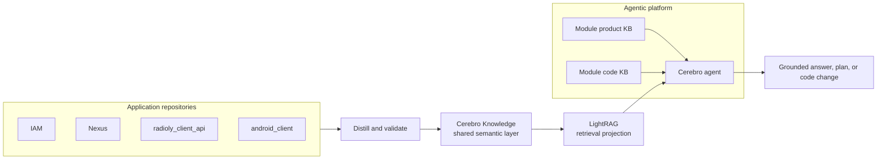

# Cerebro Knowledge

> The shared engineering memory for the agentic platform.

An application repository can tell an agent how one service is written. Cerebro Knowledge helps it understand how the wider system works: which APIs call which services, which events move data, where a field is stored, and which feature a change can affect.

## Why it exists

Without a semantic layer, an agent has to rediscover system context from source code every time it works.

With Cerebro Knowledge, that context is extracted, connected, versioned, and ready to retrieve.

## Where it fits

| Context layer | Helps an agent understand | Example question |
| --- | --- | --- |
| Module product KB | User behavior and business rules | “When should a listener see this offer?” |
| Module code KB | Local implementation and editing conventions | “Where is this Android screen built?” |
| Cerebro Knowledge | Connections across repositories and systems | “Which service publishes this event, and who consumes it?” |

Together, these layers give a Cerebro agent product intent, local code detail, and system-wide engineering context.

## Supported engineering outcomes

Cerebro supports three evidence-backed workflows:

- **Technical specifications** — discover the affected system surface, verify current contracts in source, and describe the proposed contract delta and affected consumers.
- **Customer-issue analysis** — trace the relevant journey and implementation, then correlate it with operational evidence. Without runtime evidence, the result is a hypothesis rather than a confirmed root cause.
- **Test generation** — derive scenarios from requirements, system flows, contracts, failure modes, and code branches, then verify generated tests by executing them.

LightRAG is the discovery and navigation layer. It does not replace application source for exact implementation facts, requirements for intended future behavior, or operational systems for runtime facts. See [Architecture and lifecycle](docs/architecture/README.md#engineering-outcome-architecture).

## A simple example

An engineer asks: **“Changing the onboarding login configuration—what could break?”**

| Knowledge source | What the agent can use |
| --- | --- |
| Product KB | Why the login configuration exists and the intended user journey |
| Code KB | The module, files, tests, and local coding rules |
| Cerebro Knowledge | The `radioly_client_api` endpoint, related IAM context, interfaces, data attributes, and downstream relationships |

The result is not just a file edit. The agent can explain the change in system terms, identify affected boundaries, then follow versioned evidence into a read-only source sandbox to verify exact implementation details.

## What this repository contains

| Location | Purpose |
| --- | --- |
| `resources/` | Declares which repositories, modules, and APIs belong to a semantic domain. |
| `knowledge/repositories/` | Generated knowledge for one source repository, with evidence and provenance. |
| `knowledge/merged/` | Normalized knowledge and relationships that span repositories. |
| `reconciliation/` | Durable identity decisions and the latest reconciliation report. |
| `schemas/` and `ontology/` | Shared model and safe migration contracts. |
| `skills/` | Reusable workflows for distilling, reconciling, validating, and syncing knowledge. |
| `lightrag/` | QA retrieval projection; never the source of truth. |
| `deployment/` | Environment-specific deployment assets for Cerebro services. |

Git is the canonical store and manual workflow handoff. Distillation and reconciliation changes travel through one knowledge PR; LightRAG sync runs only after merge.

## Start here

| I want to… | Read… |
| --- | --- |
| Understand the semantic layer | [Architecture and lifecycle](docs/architecture/README.md) |
| Add or update repository context | [Knowledge development](docs/development/README.md) · [Resource onboarding](resources/README.md) |
| Run the complete manual update flow | [Manual workflow](docs/workflows/README.md) |
| Understand the ontology | [Ontology reference](docs/ontology/README.md) |
| Validate knowledge | [Knowledge development](docs/development/README.md#validate-a-change) |
| Merge repository knowledge | [Knowledge reconciliation](skills/knowledge-reconcile/SKILL.md) |
| Work with the QA projection | [LightRAG README](lightrag/README.md) |
| Browse all documentation | [Documentation map](docs/README.md) |

## Current coverage

- Application repositories: IAM, Nexus, `radioly_client_api`, and `android_client`.
- Repository artifacts: `seed/`, `generated/`, and `IMPORT_MANIFEST.yaml`.
- Agent editing rules: [CLAUDE.md](CLAUDE.md) · [AGENTS.md](AGENTS.md)
